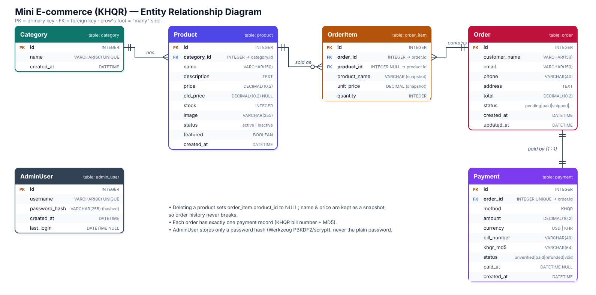
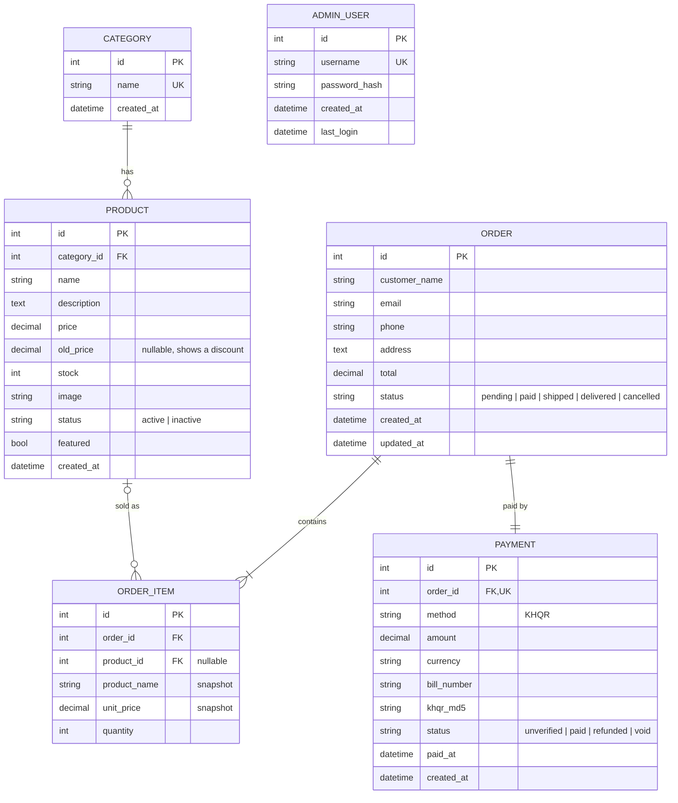

# Database design (ERD)





## Relationships

| Relationship | Cardinality | Foreign key | Why |
|---|---|---|---|
| Category → Product | 1 : N | `product.category_id` | Every product belongs to one category; categories are a real table, so names can't be mistyped into duplicates. |
| Product → OrderItem | 1 : 0..N | `order_item.product_id` (nullable, `ON DELETE SET NULL`) | A product can appear in many orders. If an admin deletes a product, old orders keep the item's **name and price snapshot**. |
| Order → OrderItem | 1 : 1..N | `order_item.order_id` | An order has one or more line items; deleting an order deletes its items (cascade). |
| Order → Payment | 1 : 1 | `payment.order_id` (unique) | Each order has exactly one KHQR payment record (bill number, MD5, status, paid time). |
| AdminUser | — | — | Stand-alone table of admin accounts; passwords are stored only as a hash. |

## Order status flow

```
pending ──(admin confirms KHQR payment)──► paid ──► shipped ──► delivered
   │                                          │
   └────────────► cancelled ◄─────────────────┘   (stock is returned; payment → void / refunded)
```

- With a `BAKONG_TOKEN`, the server verifies the KHQR payment automatically and the order starts as **paid**.
- Without a token (demo mode), the order starts as **pending** and the admin clicks **Mark payment received** after checking the Bakong app.

## Data integrity

- **No overselling:** checkout reduces stock with a single conditional `UPDATE … WHERE stock >= qty`, so two buyers can't both buy the last item.
- **Prices are snapshots:** `order_item.unit_price` stores the price at purchase time; changing a product's price later doesn't change old orders.
- **Admin security:** passwords are hashed (Werkzeug), login is rate-limited (5 failed tries per 10 minutes) and every form has a CSRF token.
